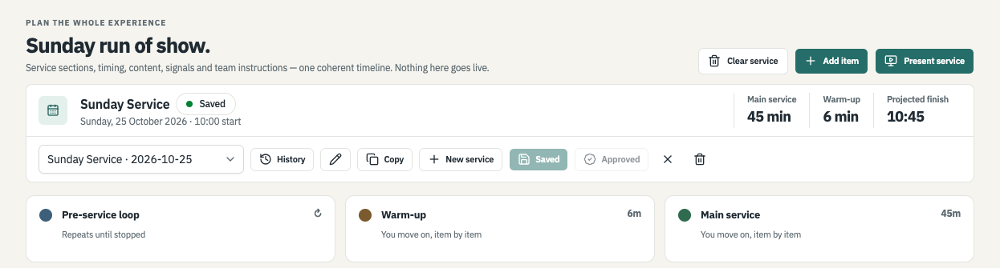
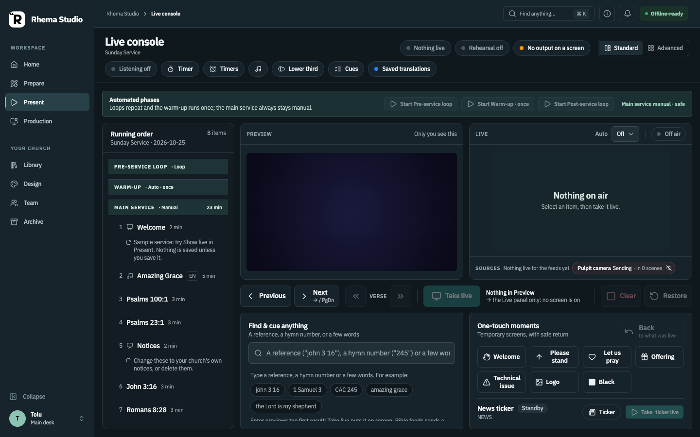
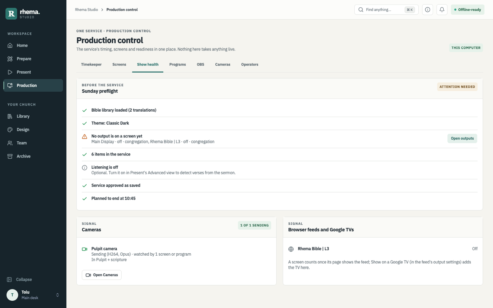
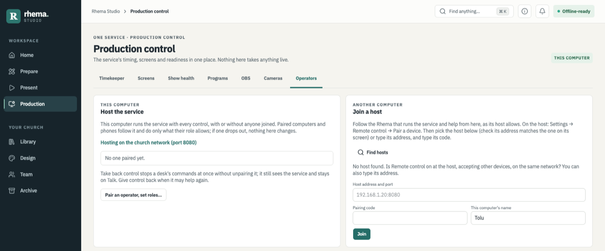
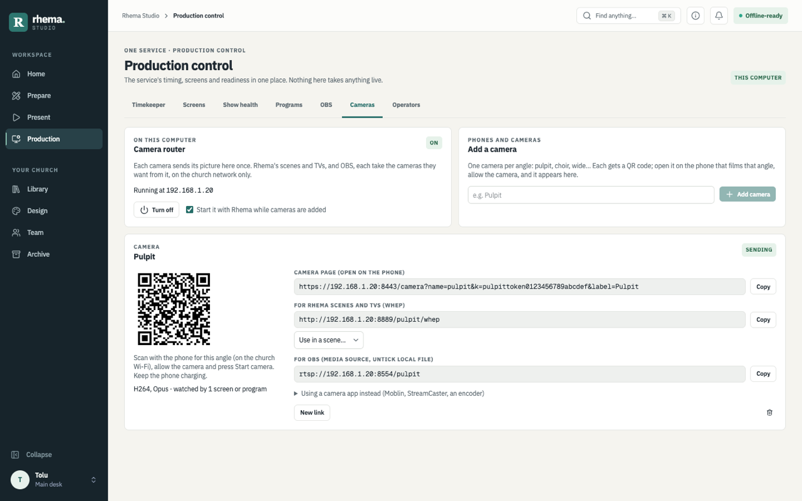
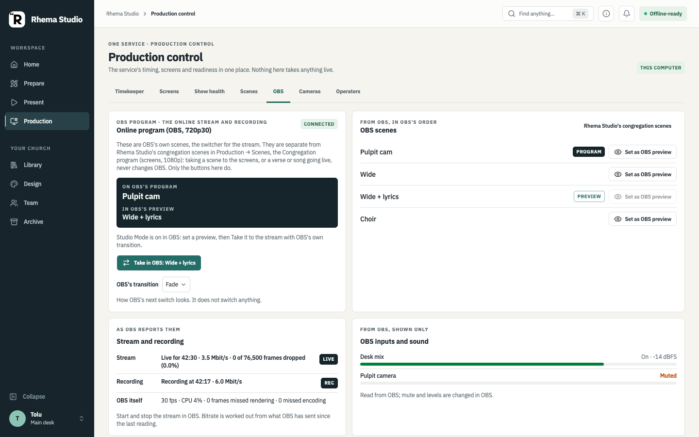

# Rhema Studio — the short manual

For the volunteer at the laptop and whoever looks after the screens on a Sunday. Nothing in **Prepare** can reach the screen; only **Present** does. The full detail for outputs, OBS, scenes and desks is in the [production guide](PRODUCTION-GUIDE.md); this page is the short version.

**What "checked" means here.** Everything described on this page is built. Where a section says *Checked on the desktop*, the rows named there passed in the [desktop acceptance guide](rhema-studio/08-desktop-acceptance-guide.md); everything else is **built, not yet checked on the desktop**. The pictures are from a test build on 24 October 2026 with made-up demo data (no real church's services or people); where a label has changed since, the caption says so.

- [Finding your way](#finding-your-way)
- [The first time on a new computer](#the-first-time-on-a-new-computer-2-minutes)
- [Home](#home)
- [Before the service: Prepare](#before-the-service-prepare-10-minutes)
- [During the service: Present](#during-the-service-present-standard-view)
- [Production](#production)
- [Design](#design)
- [Settings](#settings)
- [Your desk, joining a host and volunteer desks](#your-desk-joining-a-host-and-volunteer-desks)
- [Google TV](#google-tv)
- [Cameras](#cameras)
- [OBS](#obs)
- [If something breaks](#if-something-breaks)

## Finding your way

The sidebar has two groups. **Workspace**: **Home** (is everything ready?), **Prepare** (build the service), **Present** (the live console) and **Production** (timing, screens, health, scenes, OBS, cameras, other desks). **Your church**: **Library** (songs and ministrations, the hymn book, pictures and videos, import and export), **Design** (every look), **Team** (who is at the desk, approvals, church folder, phones and other computers) and **Archive** (what went live, songs sung, sharing services, backups).

Your name at the foot of the sidebar opens the **Desk menu**: your name, this computer's name, what this desk may do, Light / Dark / System, Settings, Complete setup, Setup status, keyboard shortcuts, help and the tour, Diagnostics and About. **Find anything** at the top (⌘K / Ctrl+K) finds a service, a song, a verse, a setting or an action. **Collapse** (⌘B / Ctrl+B) folds the sidebar to icons.

## The first time on a new computer (2 minutes)

On a new install Rhema opens **Welcome to Rhema Studio** once. Choose:

- **Set up this computer as the main desk** (recommended): the church's name, your name, then optional steps for the brand, the Bible, screens and connections. Every field saves as you type; **Skip** passes an optional step; **Finish later** stops anywhere and Rhema picks up at the same step next time.
- **Join an existing church host**: opens Production → Operators to pair with the main desk.
- **Bring in a previous installation**: a Rhema backup file, a service file or the church folder. A backup made with **Back up now** holds the services and songs and also the settings, outputs, looks (themes, lower thirds, ticker, stage, scenes) and the Brand Kit. Rhema shows what it holds and **what would change here** (church name, Brand Kit, your name, outputs, looks…) before anything is replaced, and replaces only when you press **Restore this backup**. What was here is kept as a snapshot first: **Undo this restore…** puts it back. Saved keys and passwords, paired phones and desks are never in a backup, and remote control, the AI assistant connector and cloud speech consent stay as each computer has them: enter keys again where they are used and pair phones again. Older backups have services and songs only.
- **Use Rhema now, finish later**: go straight to Home.

In **Brand and starter looks**, after your logo and colours you can pick a family of **starter looks** (optional). Rhema draws its scripture, song, notice and over-the-camera looks in your church colours so you can see them first. Nothing is added until you press **Apply…** and confirm. Then the looks are copied into your own looks and set on the outputs that are **off**; an output that is on, the stage display and signage keep what they have.

In **Screens**, **Test this screen** checks an output that is on: after you confirm, that one output shows bars, its name and size and "TEST – not on air" until you press **End test** (it asks again if something is on air or a stream or TV is watching). Browser feeds say whether a page really shows them ("Shown on 1 page") or not ("Connected, not shown").

In **Church identity** you can choose the church's **time zone** (it starts on this computer's own). In **Screens**, a **Sound (optional)** box chooses the microphone Rhema listens with; Rhema asks the computer for its microphones only when you press **Choose microphone**.

The **Setup summary** at the end shows where services and songs are kept (**Copy**, **Show in folder**), when they were last backed up (**Back up now…** saves a backup file where you choose), and tests the church folder by writing a small file there and deleting it again. **Run screen test** goes back to Screens; **Start a sample service** opens Prepare with a welcome, a few passages from your Bible, notices and a closing slide (no song words, not saved unless you save it; it will not replace a service with unsaved changes).

Nothing in the setup turns on a screen, a microphone or a listener, and no internet or cloud key is needed. A computer that was already in use before the setup existed sees **Review your setup** on Home once (Review setup, or Not now); nothing changes unless you choose. Home's **Content readiness** counts checks ("5 of 6 checks"), not a percentage, and with no outputs set up, or a service hours away, "No output is on a screen yet" is a note, not a reason for "Not ready". Until the church's name, your name and a Bible are in place, Home shows a small **Finish church setup** card (Continue, Remind me tomorrow, or hide it). Features you do not use, such as NDI, OBS or cloud speech, are listed as **Not using** and never count against you. **Setup status** (Desk menu, or the Home card) shows the church's setup, the equipment that is switched on and this service side by side, each item with a link to fix it.

*Built, not yet checked on the desktop (acceptance 10dn, 10dv, 10eq, 10er, 10ev).*

## Home

Home is the first thing to look at on a Sunday morning. It shows the next service, how much is planned, **Content readiness** (so many of so many checks: the Bible loaded, a look chosen, an output on a screen, songs and pictures present, fonts installed) and **Your attention**: each line that needs fixing, with a button that takes you there. Fix the amber lines first. **Team changes** lists the latest saves, approvals and new team comments on the service; a row opens it in Prepare. Until the church's name, your name and a Bible are in place, a **Finish church setup** card offers the rest of the setup.

*Checked on the desktop: today's service on Home (10x.1). Content readiness, Team changes and the setup card are built, not yet checked on the desktop (acceptance 10du, 10eq.11, 10dn.5).*

## Before the service: Prepare (10 minutes)

First time at this computer? Click **Add your name** at the bottom of the sidebar and type your name (Enter saves). The same menu switches Light, Dark or System and opens Settings, setup and help. Want more room? **Collapse** (just above your name, or ⌘B / Ctrl+B) folds the sidebar to icons; it stays that way on this computer until you expand it.

1. **Home** tells you if anything is wrong: Bible loaded, theme chosen, an output on a screen, songs and pictures all present, fonts installed. Fix the amber lines first; the Fix button takes you there.
2. **Prepare → New service** (or Copy last week's). Give it a date. Prepare is the one place to build the service; beside its name it says **Saved**, **Unsaved changes** or **Not saved as a service**. Save, Copy, History and Approve all act on that service.
3. Add items in the order of the service:
   - **Bible**: type `john 3 16` or a few words, press Add. A book or chapter alone works too (`1 Samuel`, `1 Kings 3`), and so do ordinals in words (`First Samuel 3:10`, `Samuẹli Kínní 3:10`).
   - **Hymn book**: the CAC Gospel Hymn Book in English and Yorùbá (Part 1 and Part 2). Type the number (`245`, or `V12` for Part 2) or a few words in either language; click to preview, Add. "First: Yorùbá / English" sets which language comes first. The first time, press **Import the hymn book…** and choose the hymn book file; it stays on this computer.
   - **Songs**: search by title, a line of the words, or a hymn number like `245`. New song: paste the words, put a blank line between verses, write `Chorus` (or `Ẹgbẹ́ orin`) above the chorus, Make sections, Save. Slides → **Responsive reading**: start the leader's lines with `L:` and the congregation's with `P:` (or `All:`); each exchange becomes a slide. Headings from other places work too (`## Chorus`, `[Verse 1]`, `**Bridge**`). Team → "Ask before showing an unapproved service" makes the first Take live of an unapproved service ask first (off by default; never while already on air). In Prepare each item can carry team comments (never on screen; they travel with the service file, and "n new comments" shows what others wrote) and can name the **People** preparing it (type a name and press Enter for each; names already on the service are offered; the rundown shows the first and how many more, "· Tolu +2", and Run of show has a People column; an older Rhema sees them as one "prepared by" line), and History shows who saved each version (from Team → Your name). The pencil beside the service name renames or re-dates it, marks it as a **template** (then New service → Start from offers it: 9 am, communion, youth) or **archives** it (hidden from the list, kept; "Show archived" finds it). **Text…** in the song editor saves a song as plain text to print or share; pasting that text back gives the same sections.
   - **Slides**: Any text or Announcement (when, where, details).
   - **Pictures**: Import once; Add to the service.
4. Click an item to set its languages (EN · YO), its order, a background picture, its planned time (`35`, `4:30`, `1:10:00` or `1h10`), or a note to yourself.
5. **Save.** The service is kept with every version (History) and backed up before upgrades.

**Timing → Table** shows the whole run of show: the plan, what happened and what is now expected, with a People column. **Look and scene** on an item (Slides tab) records the scene, look and camera it is meant to have; it changes no screen. Tick **Take its scene** under **Signals → When you Take it** if Present should take that scene when you take the item live.

*Checked on the desktop: 10dm.2 (a closed service says "Not saved as a service") and 10dg.1 (the run-of-show table). The rest is built, not yet checked on the desktop (acceptance 10dm, 10ep, 10ex).*

## During the service: Present (Standard view)

| Want to… | Do |
|---|---|
| Show the next item or slide | **Next** (→ or PgDn). On a wide window the button says what comes next. |
| Go back | **Previous** (←). |
| Show what is in the preview | **Take live** (the teal button in the middle of the bar). The preview is exactly what will appear; the words beside it say what and where (the main screens, or this console only in rehearsal). On a small window (under 1200 pixels wide) the preview is the one line with a small picture just above the bar. The Live panel's badge says **On air**, **Off air** or **Rehearsal**; Take live, Clear and Restore are the only go-live buttons (the old Go live switch is in the Advanced view). |
| Continue a reading | **Next verse** / **Previous verse** (the » and « buttons, Shift+→ / Shift+←). Stays in the same Bible version. While a song, slide or quick screen is up they wait and say why: take a verse live first. |
| Take the screen down | **Clear** (Esc). **Restore** (Shift+Esc) brings it back. |
| Please stand / Let us pray / Welcome / Offering / Technical issue / Logo / Black | **Quick screens**; **Back** returns to what was live. Black is a black screen (on the stream it shows nothing); Logo shows the church logo large. |
| A verse the preacher just mentioned | Type it in **Quick find**, press Enter to preview, then Take live. |
| Keep an eye on time | **Timer** in the header: set the planned minutes, Start. Amber under two minutes, red when over. |
| Tell the band something | **Message stage**. Only the stage screen sees it. |
| Change how the projector is arranged (camera with the verse, lyrics on a picture…) | **Scenes**, under Live: click a scene, then **Take scene**. **Own feed** goes back; **Restore** brings the last scene back. It does not change what is live. If the item in Preview was planned with a scene, that one is already picked (**For Preview**); you still press Take scene. |
| Practise without touching the projector | **Rehearsal on**. Everything works in the app; the screens keep what they showed. Turning it off brings back exactly that; **Show this live** puts what you rehearsed on screen. |

Things that cannot go wrong by accident: nothing goes live before it has loaded; a missing song, picture or translation is reported and the screen keeps what it had; Prepare never presents; the timer ignores the computer's clock.

The **Sources** line under Live lists what each live source holds (Bible, songs, the ticker, the timer, the lower third, the stage message, each camera) and who changed it last; × takes one off, **Restore** brings it back. **Lower third** in the header puts a name band on the outputs that show lower thirds; **Ticker** starts the news ticker.

*Checked on the desktop: Clear, Restore, Back and quick screens (10ca.1–10ca.4, 10ca.7), Black (10ai.1) and the ticker in Sources (10ec.1). The transport bar, the Scenes strip and New scene are built, not yet checked on the desktop (acceptance 10dj, 10et, 10ds, 10eu.8–10eu.10, 10es).*

## Production

Production is for the person looking after the screens and the stream. Nothing here takes anything live. Its tabs:

| Tab | What it is for |
|---|---|
| **Timekeeper** | The service clock: start the next event, running late or early (±5 min), the service timer, a countdown to the next item, Hold with a reason. |
| **Screens** | A card for every output (projector, NDI sender, browser feed): where it goes, what it follows, its look, language, safe area and what it shows now. **Add a ready-made feed** adds outputs for OBS ("Rhema Bible \| Lower third" and others). **Needs attention** lists real problems first. |
| **Show health** | What each audience is really getting: the Sunday preflight, cameras, browser feeds and Google TVs, this computer's load and network, and NDI frames sent. |
| **Scenes** | The scene composer: arrange the Bible, lyrics, a camera, a video, a clock, the ticker and the logo on one frame, then **Take** it to a congregation screen. (This tab was called **Programs** before.) |
| **OBS** | OBS's own scenes, separate from Rhema's. See [OBS](#obs). |
| **Cameras** | Phones and cameras on the church Wi-Fi. See [Cameras](#cameras). |
| **Operators** | Host the service or join a host. See [Your desk](#your-desk-joining-a-host-and-volunteer-desks). |

*In the picture the cards are from before the safe area and the "Congregation program" name were added.*

*In the picture Show health is from before **This computer** (load, heat, network) and **NDI senders** were added below.*

*Checked on the desktop: the OBS tab (10ek.1–10ek.9), a camera that stops sending in Show health (10dy.4), the first Show health check (10db.1), running late and the timer from a joined desk (10de.1–10de.3), the run-of-show table (10dg.1). Scenes, Screens and the capacity limits are built, not yet checked on the desktop (acceptance 10cs, 10eu, 10dl, 10ew).*

## Design

Design is where every look is made: **Themes** (how verses, songs, slides and pictures look), **Library** (ready-made looks in six families), **Lower thirds**, **News ticker**, **Stage**, **Countdown** (one big time that turns amber, then red, as time runs out; show it on a stage output or the ready-made feed **Rhema Countdown**), **Brand kit** (church name, colours, fonts, logo) and **Used on…** (which outputs use each look, with **Open output** to change it). **Use** in the Library adds your own copy; nothing on the screens changes until you choose that copy for an output. Edits to a look stay a draft in Design until you save; **Live edit** (off unless you turn it on) shows a draft on the screens as you edit.

*In the picture the Library is from before the **OBS overlay** filter was added.*

*Checked on the desktop: the scripture-strip lower third, lower-third styles, the stage over NDI, signage and the ticker (10co.2–10co.6). The Library, Used on…, output cards, a different look per content and the Countdown display are built, not yet checked on the desktop (acceptance 10dk, 10er, 10dl, 10co.1, 10fh).*

## Settings

Open Settings from the Desk menu (or ⌘, / Ctrl+,). The left list groups the sections: **Bible and languages**, **Display and output** (Outputs, Heard verses), **Microphone and speech** (Audio, Speech Recognition), **Connections** (Remote Control, AI assistants) and **Data and diagnostics**. Type in the search box to find any setting ("gain", "camera", "backup"); settings that live elsewhere (the church's name, appearance, cameras, hosting) are listed under **Elsewhere in Rhema** with a link. Settings are kept on this computer; saved keys and passwords go into the system keychain where there is one, and a backup never carries them.

*Built, not yet checked on the desktop (acceptance 10dt, 10di.12–10di.14, 10es.9, 10ev.11).*

### AI assistants (planning help)

**Settings → AI assistants** lets an assistant that speaks MCP (Claude Desktop, for example) help plan a service on this computer. It is off until you turn it on. Once on, the assistant can read your services (and the version you approved), songs and hymns (titles, arrangements and licences, never lyrics), the Bible editions installed here, and the names of your screens and feeds, cameras, media and Brand Kit colours and fonts. It never sees links, keys or passwords. It cannot change a service or a screen, and it cannot take anything live.

- **What it plans arrives as a draft** in Prepare → **AI drafts**, with the check's warnings (a song with no licence recorded, a camera you do not have). Opening a draft puts it in the rundown unsaved and marks it **Opened**: the assistant can no longer revise it.
- **Slides the assistant wrote** say **AI suggestion** in the rundown until you check the words and press **Accept** in the item's editor.
- A draft can plan a stage message, a cue as the item goes live, a camera, a second Bible translation, a song's languages and arrangement, and steps for your own Take. Nothing runs until you Take the item.
- **Turning it off** refuses the assistant's very next request. Rhema answers at most 30 requests a minute. Drafts that are waiting go into **Back up now** and come back on restore, beside the ones already here.

*Built, not yet checked on the desktop (acceptance 10eg, 10fe).*

## Your desk, joining a host and volunteer desks

One computer, the **main desk** (the host), runs the service and keeps every control. Other computers and phones can help, each with a **role** the host gives it; nobody else is needed.

- **On the host:** Settings → Remote Control: start the HTTP listener and allow other devices on the network. Production → Operators → **Pair an operator, set roles…** gives a code, and sets each device's role.
- **On the helping computer:** Production → Operators → **Join a host**: pick the host Rhema found (check its address matches the host's Settings), type the code and this computer's name, **Join**. The Desk menu then says what this desk may do, and **Leave this host** stops following.
- **Roles:** **Timekeeper** (the event clock, running late, the timer, Hold), **Bible** (a reference, its verses, the Bible source), **Screens** (congregation scenes), **Present** (all of these and moving through the service), **Present and settings** (also looks and on-air settings). Notices and the talk channel are for every role. What each role may do is listed in the [Production guide](PRODUCTION-GUIDE.md).
- **Take back control** (Production → Operators, beside each desk) stops a desk's commands at once without unpairing it; **Give control back** ends it.
- A joined desk that hears nothing from the host for 5 seconds says **Last update N s ago** and dims its clock; it reconnects by itself.

*Checked on the desktop on one Mac, with the joined desks simulated by their keys (no second computer): a Bible key cannot Hold (10ef.4), a paused desk's commands are refused (10dq.3), a desk on another service is refused (10dq.5), running late and the timer from a joined desk (10de.2, 10de.3), Timekeeper commands (10cu.2, 10cu.3), notices (10cu.8), priority talk and revoking a talking desk (10dd.1, 10dd.2). A two-computer run is not yet checked (acceptance 10cu.1, 10eq.3, 10ev.1).*

## Google TV

A Chromecast with Google TV (or another Android TV) can show a browser feed full screen with the **Rhema Receiver** app. Install it once from a computer (`android-tv/build.sh`, then `adb install`). In Rhema tick **Secure page for phones (https)** in Settings → Remote Control and start the listener. Open Rhema Receiver on the TV: it shows its name, address and a six-digit code. In Rhema, open the browser feed's settings → **Show on a Google TV**, pick the TV whose address matches, type the code from the TV, **Show on TV**. The TV keeps the feed after a restart or a power cut, keeps the last picture if the network drops, and picks up again by itself. **OK** on the TV's remote shows a new code to send another feed. Show health lists each TV, with **Check TV**.

*Checked on the desktop with a Chromecast with Google TV HD: install and code (10dh.1), the feed on the TV (10dh.2), verses within a second (10dh.3), the ticker (10dh.4), restart and network loss (10dh.5), five wrong codes (10dh.6), a camera scene on the TV (10dh.8), the secure link (10en.0, 10en.2, 10en.3, 10en.8), Rhema finding the TV (10dz.3) and a smooth ticker layer (10eb.1).*

## Cameras

Phones on the church Wi-Fi can be cameras. Production → Cameras → type a name ("Pulpit") → **Add camera**; scan its QR code with the phone, allow the camera and press **Start camera**. Each camera goes once to the camera router that comes with Rhema; a scene's Camera layer picks it by name, and OBS takes its RTSP address in a Media Source. While a camera is not sending, its box in a scene shows colour bars (or TV static, words or nothing: **When the camera isn't sending** on the Camera layer). Phones need the secure phone page (Settings → Remote Control → **Secure page for phones (https)**). Nothing goes to the internet. **New link** closes the old link. Step by step: [cameras](rhema-studio/cameras.md).

*In the picture the Production tab is still called **Programs**; it is **Scenes** now.*

*Checked on the desktop: the router's own page needs a password (10do.12), words in a camera's box while it is not playing (10dc.4; now the **Words** choice; colour bars and TV static are 10fg, not yet checked), a camera that stops sending in Show health (10dy.4), a camera scene on a Google TV (10dh.8). Adding a phone end to end is not yet checked (acceptance 10do).*

## OBS

Rhema works beside OBS in two ways:

- **Pictures into OBS:** **Production → Screens → Add a ready-made feed** adds an output named for OBS ("Rhema Bible | Lower third", "Rhema Lyrics | Full", "Rhema Ticker | Alpha"…) as an NDI sender (add an NDI source in OBS) or a browser feed (paste its link into an OBS Browser source, 1920×1080). A Bible feed keeps the verse while a hymn is on the projector and changes the moment the next verse is shown.
- **The cameras in OBS on another computer:** install Rhema on the OBS computer and choose **This computer runs OBS only (companion)** in the first-run setup (or the Desk menu). It shows one small screen: join the main computer, connect to OBS there, and **Add to OBS** on each camera. Each phone still sends once; OBS cuts between the cameras on its own, and the main computer's Production → Cameras shows which are **On OBS**. Step by step: [A second computer for OBS](PRODUCTION-GUIDE.md#a-second-computer-for-obs). *Built, not yet checked on the desktop (acceptance 10fc).*
- **OBS's own scenes:** connect in Settings → Remote Control → **Connect to OBS** (OBS's address, port 4455 and its WebSocket password). The Present header then shows OBS's recording state. **Production → OBS** lists OBS's scenes and which is on OBS's program; in Studio Mode **Set as OBS preview** and **Take in OBS**, otherwise **Switch OBS to this scene…** (it asks first). Taking a Rhema scene or showing a verse never changes OBS; only these buttons do. In rehearsal they do nothing.

*In the picture the left card is titled "OBS program"; it is now **Online program (OBS, 720p30)**, with OBS's real size and frame rate.*

*Checked on the desktop with OBS Studio on the Intel Mac: the OBS tab, Studio Mode, Take in OBS, switching, and recovering when OBS closes (10ek.1–10ek.9). The ready-made feeds and the recording state are built, not yet checked on the desktop (acceptance 10es.5, 10ag, 10ex.8).*

## If something breaks

- **Screen shows nothing?** Home → outputs. Turn the output on; check it is a *congregation* output, not *stage*.
- **Wrong language on screen?** Present header: "Saved translations" means items show in the version they were saved with; click it to override with your current Bible.
- **Lost a service?** Prepare → History picks any earlier version. Archive restores a whole backup.
- **Need help?** Settings → Diagnostics saves the logs to send.
- **Rhema closed unexpectedly?** Start it again: a banner shows what was on the screens. **Put back on the screens** brings back the program, sources, outputs with their scenes and the timer (still counting); **Not now** leaves everything off, and the Desk menu keeps the offer until Rhema closes. Nothing goes back on air by itself. *Checked on the desktop: 10da.1–10da.5.*
- **A new or replaced computer?** Archive → Backups → **Back up now…** regularly. On the new computer, **Bring in a previous installation** shows what would change, restores services, songs, settings, outputs and looks, and keeps what was there for **Undo this restore**. Keys, passwords and paired phones are never in a backup: enter and pair them again. *Built, not yet checked on the desktop (acceptance 10ev).*
