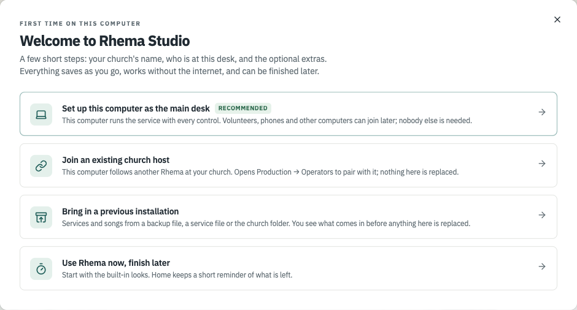
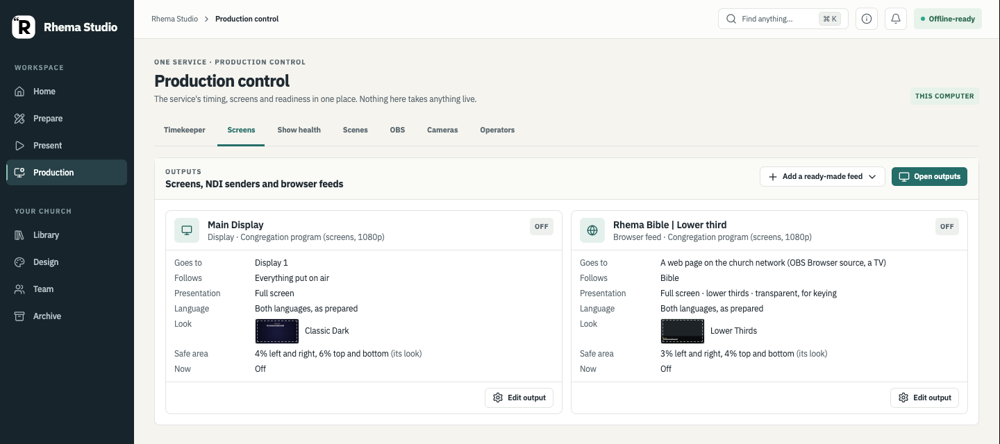
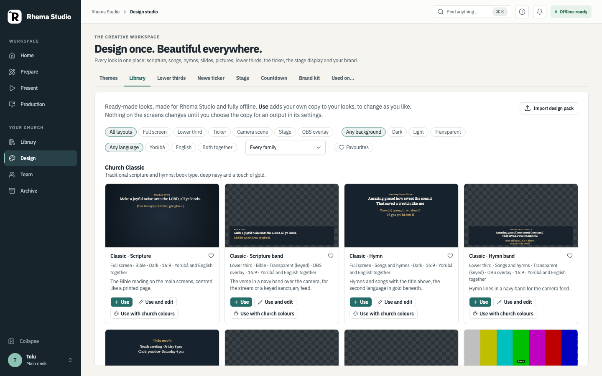
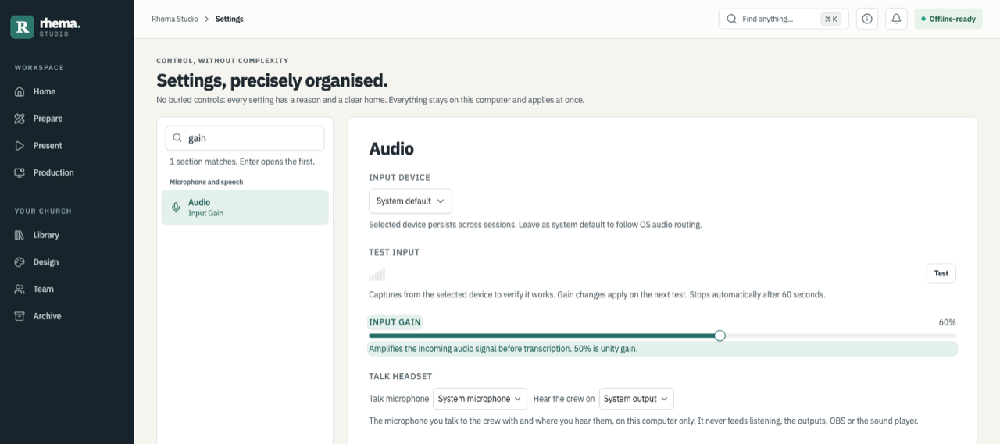

# Rhema Studio — the short manual

For the volunteer at the laptop and whoever looks after the screens on a Sunday. Nothing in **Prepare** can reach the screen; only **Present** does. The full detail for outputs, OBS, scenes and desks is in the [production guide](PRODUCTION-GUIDE.md); this page is the short version.

**What "checked" means here.** Everything described on this page is built. Where a section says *Checked on the desktop*, the rows named there passed in the [desktop acceptance guide](rhema-studio/08-desktop-acceptance-guide.md); everything else is **built, not yet checked on the desktop**. The pictures were taken on 25 October 2026 from the current build's own screens, run in a browser with made-up demo data (a sample service with a welcome slide, John 3:16 and the public-domain hymn Amazing Grace; no real church's services or people), light theme, 1440×900. The Present console is always dark.

- [Finding your way](#finding-your-way)
- [The first time on a new computer](#the-first-time-on-a-new-computer-2-minutes)
- [Home](#home)
- [Before the service: Prepare](#before-the-service-prepare-10-minutes)
- [During the service: Present](#during-the-service-present-standard-view)
- [Editing the run of show](#editing-the-run-of-show)
- [Production](#production)
- [Design](#design)
- [The countdown display](#the-countdown-display)
- [Settings](#settings)
- [Connecting an AI assistant](#connecting-an-ai-assistant)
- [Your desk, joining a host and volunteer desks](#your-desk-joining-a-host-and-volunteer-desks)
- [Comms: Talk, notices and the phone page](#comms-talk-notices-and-the-phone-page)
- [Remote control: the security defaults](#remote-control-the-security-defaults)
- [Google TV](#google-tv)
- [Cameras](#cameras)
- [Rhema Studio Cam (Android)](#rhema-studio-cam-android)
- [OBS](#obs)
- [A second computer for OBS](#a-second-computer-for-obs)
- [If something breaks](#if-something-breaks)

## Finding your way

The sidebar has two groups. **Workspace**: **Home** (is everything ready?), **Prepare** (build the service), **Present** (the live console) and **Production** (timing, screens, health, scenes, OBS, cameras, other desks). **Your church**: **Library** (songs and ministrations, the hymn book, pictures and videos, import and export), **Design** (every look), **Team** (who is at the desk, approvals, church folder, phones and other computers) and **Archive** (what went live, songs sung, sharing services, backups).

Your name at the foot of the sidebar opens the **Desk menu**: your name, this computer's name, what this desk may do, Light / Dark / System, Settings, Complete setup, Setup status, keyboard shortcuts, help and the tour, Diagnostics and About. **Find anything** at the top (⌘K / Ctrl+K) finds a service, a song, a verse, a setting or an action. **Collapse** (⌘B / Ctrl+B) folds the sidebar to icons.

## The first time on a new computer (2 minutes)

On a new install Rhema opens **Welcome to Rhema Studio** once. Choose:

- **Set up this computer as the main desk** (recommended): the church's name, your name, then optional steps for the brand, the Bible, screens and connections. Every field saves as you type; **Skip** passes an optional step; **Finish later** stops anywhere and Rhema picks up at the same step next time.
- **Join an existing church host**: opens Production → Operators to pair with the main desk.
- **This computer runs OBS only (companion)**: for the computer that streams with OBS. See [A second computer for OBS](#a-second-computer-for-obs).
- **Bring in a previous installation**: a Rhema backup file, a service file or the church folder. A backup made with **Back up now** holds the services and songs and also the settings, outputs, looks (themes, lower thirds, ticker, stage, scenes) and the Brand Kit. Rhema shows what it holds and **what would change here** (church name, Brand Kit, your name, outputs, looks…) before anything is replaced, and replaces only when you press **Restore this backup**. What was here is kept as a snapshot first: **Undo this restore…** puts it back. Saved keys and passwords, paired phones and desks are never in a backup, and remote control, the AI assistant connector and cloud speech consent stay as each computer has them: enter keys again where they are used and pair phones again. Older backups have services and songs only.
- **Use Rhema now, finish later**: go straight to Home.

In **Brand and starter looks**, after your logo and colours you can pick a family of **starter looks** (optional). Rhema draws its scripture, song, notice and over-the-camera looks in your church colours so you can see them first. Nothing is added until you press **Apply…** and confirm. Then the looks are copied into your own looks and set on the outputs that are **off**; an output that is on, the stage display and signage keep what they have.

In **Screens**, **Test this screen** checks an output that is on: after you confirm, that one output shows bars, its name and size and "TEST – not on air" until you press **End test** (it asks again if something is on air or a stream or TV is watching). Browser feeds say whether a page really shows them ("Shown on 1 page") or not ("Connected, not shown").

In **Church identity** you can choose the church's **time zone** (it starts on this computer's own). In **Screens**, a **Sound (optional)** box chooses the microphone Rhema listens with; Rhema asks the computer for its microphones only when you press **Choose microphone**.

The **Setup summary** at the end shows where services and songs are kept (**Copy**, **Show in folder**), when they were last backed up (**Back up now…** saves a backup file where you choose), and tests the church folder by writing a small file there and deleting it again. **Run screen test** goes back to Screens; **Start a sample service** opens Prepare with a welcome, a few passages from your Bible, notices and a closing slide (no song words, not saved unless you save it; it will not replace a service with unsaved changes).

Nothing in the setup turns on a screen, a microphone or a listener, and no internet or cloud key is needed. A computer that was already in use before the setup existed sees **Review your setup** on Home once (Review setup, or Not now); nothing changes unless you choose. Home's **Content readiness** counts checks ("5 of 6 checks"), not a percentage, and with no outputs set up, or a service hours away, "No output is on a screen yet" is a note, not a reason for "Not ready". Until the church's name, your name and a Bible are in place, Home shows a small **Finish church setup** card (Continue, Remind me tomorrow, or hide it). Features you do not use, such as NDI, OBS or cloud speech, are listed as **Not using** and never count against you. **Setup status** (Desk menu, or the Home card) shows the church's setup, the equipment that is switched on and this service side by side, each item with a link to fix it.

*Built, not yet checked on the desktop (acceptance 10dn, 10dv, 10eq, 10er, 10ev).*

## Home

Home is the first thing to look at on a Sunday morning. It shows the next service, how much is planned, **Content readiness** (so many of so many checks: the Bible loaded, a look chosen, an output on a screen, songs and pictures present, fonts installed) and **Your attention**: each line that needs fixing, with a button that takes you there. Fix the amber lines first. **Team changes** lists the latest saves, approvals and new team comments on the service; a row opens it in Prepare. Until the church's name, your name and a Bible are in place, a **Finish church setup** card offers the rest of the setup.

*Checked on the desktop: today's service on Home (10x.1). Content readiness, Team changes and the setup card are built, not yet checked on the desktop (acceptance 10du, 10eq.11, 10dn.5).*

## Before the service: Prepare (10 minutes)

First time at this computer? Click **Add your name** at the bottom of the sidebar and type your name (Enter saves). The same menu switches Light, Dark or System and opens Settings, setup and help. Want more room? **Collapse** (just above your name, or ⌘B / Ctrl+B) folds the sidebar to icons; it stays that way on this computer until you expand it.

1. **Home** tells you if anything is wrong: Bible loaded, theme chosen, an output on a screen, songs and pictures all present, fonts installed. Fix the amber lines first; the Fix button takes you there.
2. **Prepare → New service** (or Copy last week's). Give it a date. Prepare is the one place to build the service; beside its name it says **Saved**, **Unsaved changes** or **Not saved as a service**. Save, Copy, History and Approve all act on that service.
3. Add items in the order of the service:
   - **Bible**: type `john 3 16` or a few words, press Add. A book or chapter alone works too (`1 Samuel`, `1 Kings 3`), and so do ordinals in words (`First Samuel 3:10`, `Samuẹli Kínní 3:10`).
   - **Hymn book**: the CAC Gospel Hymn Book in English and Yorùbá (Part 1 and Part 2). Type the number (`245`, or `V12` for Part 2) or a few words in either language; click to preview, Add. "First: Yorùbá / English" sets which language comes first. The first time, press **Import the hymn book…** and choose the hymn book file; it stays on this computer.
   - **Songs**: search by title, a line of the words, or a hymn number like `245`. New song: paste the words, put a blank line between verses, write `Chorus` (or `Ẹgbẹ́ orin`) above the chorus, Make sections, Save. Slides → **Responsive reading**: start the leader's lines with `L:` and the congregation's with `P:` (or `All:`); each exchange becomes a slide. Headings from other places work too (`## Chorus`, `[Verse 1]`, `**Bridge**`). Team → "Ask before showing an unapproved service" makes the first Take live of an unapproved service ask first (off by default; never while already on air). In Prepare each item can carry team comments (never on the congregation feed; they travel with the service file, and "n new comments" shows what others wrote). Set your name in Team before commenting; only the named author can remove a comment, and the removal stays in the service history with who and when. The operator name is a self-selected label on this computer, not account authentication. Items can also name the **People** preparing them (type a name and press Enter for each; names already on the service are offered; the rundown shows the first and how many more, "· Tolu +2", and Run of show has a People column; an older Rhema sees them as one "prepared by" line), and History shows who saved each version (from Team → Your name). The pencil beside the service name renames or re-dates it, marks it as a **template** (then New service → Start from offers it: 9 am, communion, youth) or **archives** it (hidden from the list, kept; "Show archived" finds it). **Text…** in the song editor saves a song as plain text to print or share; pasting that text back gives the same sections.
   - **Slides**: Any text or Announcement (when, where, details).
   - **Pictures**: Import once; Add to the service.
4. Click an item to set its languages (EN · YO), its order, a background picture, its planned time (`35`, `4:30`, `1:10:00` or `1h10`), or a note to yourself.
5. **Save.** The service is kept with every version (History) and backed up before upgrades.

**Timing → Table** shows the whole run of show: the plan, what happened and what is now expected, with a People column. **Look and scene** on an item (Slides tab) records the scene, look and camera it is meant to have; it changes no screen. Tick **Take its scene** under **Signals → When you Take it** if Present should take that scene when you take the item live.

*Checked on the desktop: 10dm.2 (a closed service says "Not saved as a service") and 10dg.1 (the run-of-show table). The rest is built, not yet checked on the desktop (acceptance 10dm, 10ep, 10ex).*

## During the service: Present (Standard view)

| Want to… | Do |
|---|---|
| Show the next item or slide | **Next** (→ or PgDn). On a wide window the button says what comes next. |
| Go back | **Previous** (←). |
| Show what is in the preview | **Take live** (the teal button in the middle of the bar). The preview is exactly what will appear; the words beside it say what and where (the main screens, or this console only in rehearsal). On a small window (under 1200 pixels wide) the preview is the one line with a small picture just above the bar. The Live panel's badge says **On air**, **Off air** or **Rehearsal**; Take live, Clear and Restore are the only go-live buttons (the old Go live switch is in the Advanced view). |
| Continue a reading | **Next verse** / **Previous verse** (the » and « buttons, Shift+→ / Shift+←). Stays in the same Bible version. While a song, slide or quick screen is up they wait and say why: take a verse live first. |
| Take the screen down | **Clear** (Esc). **Restore** (Shift+Esc) brings it back. |
| Please stand / Let us pray / Welcome / Offering / Technical issue / Logo / Black | **Quick screens**; **Back** returns to what was live. Black is a black screen (on the stream it shows nothing); Logo shows the church logo large. |
| A verse the preacher just mentioned | Type it in **Quick find**, press Enter to preview, then Take live. |
| Keep an eye on time | **Timer** in the header: set the planned minutes, Start. Amber under two minutes, red when over. |
| Tell the band something | **Message stage**. Only the stage screen sees it. |
| Change how the projector is arranged (camera with the verse, lyrics on a picture…) | **Scenes**, under Live: click a scene, then **Take scene**. **Own feed** goes back; **Restore** brings the last scene back. It does not change what is live. If the item in Preview was planned with a scene, that one is already picked (**For Preview**); you still press Take scene. |
| Pause a video that is on air | **Pause video** in the Live panel: every screen, NDI and the stage hold the frame and the sound stops; **Resume video** carries on from the same moment. |
| Practise without touching the projector | **Rehearsal on**. Everything works in the app; the screens keep what they showed. Turning it off brings back exactly that; **Show this live** puts what you rehearsed on screen. |

Things that cannot go wrong by accident: nothing goes live before it has loaded; a missing song, picture or translation is reported and the screen keeps what it had; Prepare never presents; the timer ignores the computer's clock.

The **Sources** line under Live lists what each live source holds (Bible, songs, the ticker, the timer, the lower third, the stage message, each camera) and who changed it last; × takes one off, **Restore** brings it back. **Lower third** in the header puts a name band on the outputs that show lower thirds; **Ticker** starts the news ticker.

*Checked on the desktop: Clear, Restore, Back and quick screens (10ca.1–10ca.4, 10ca.7), Black (10ai.1) and the ticker in Sources (10ec.1). The transport bar, the Scenes strip, New scene and Pause video are built, not yet checked on the desktop (acceptance 10dj, 10et, 10ds, 10eu.8–10eu.10, 10es, 10ff.11–10ff.12).*

## Editing the run of show

Prepare's **order of service** is edited like a document. None of this changes what is on air.

- **Phases.** **Organise into phases** splits the service into a pre-service loop, a warm-up, the main service and a post-service loop. **Phase** (under the order of service) adds a phase of your own before the selected item ("Baptism"); rename or remove it from its ⋯ menu. **Skip this phase in this service** keeps the phase and its items but Present passes over them (no pre-service loop this week); **Use this phase in this service** brings it back.
- **Undo and Redo**: the arrows above the order of service, or ⌘Z and ⇧⌘Z (Ctrl+Z, Ctrl+Shift+Z). Every change to the order is one step (adding, removing, moving, renaming, settings); typing in one field is one step. In a text field ⌘Z undoes only the typing.
- **Several at once.** Shift-click picks a range, ⌘-click (Ctrl-click) one more. A bar says how many are picked, with Move up, Move down, Move to (a phase or group), Hide, Copy and Remove.
- **Copy and paste** (⌘C, ⌘V, or the buttons): the copies land after the selected item, in its phase, also in another service.
- **Hide** an item with the eye on its row: it stays in the service (marked **Hidden**), but Present leaves it out and Next goes past it, and so does the stage's Next.
- **Cues** (an item → Signals → Cues → Add a cue): something that happens by itself when the item starts, when its planned time is up, when it is paused (a hold or the timer paused) or when it ends: a stage message, an OBS recording marker (a chapter in the recording and a line in the service log) or a timer step. Cues never change what the congregation sees and never run in rehearsal.
- **Cue-only items** (**Cue** under the order of service): a moment with nothing on screen, such as "Sermon begins" with an OBS marker. Taking it in Present runs its cues and starts its time; the screens keep what they show.
- **Title slide first** on a song item shows a slide with the title and authors before the words.
- **Approved songs keep their words.** After **Approve**, a song edited in the library says **Changed since approval**; Present shows the approved words unless you choose **Use the new words** (or approve again).
- An item's **Timing** tab can make it a **milestone** (a moment with no minutes), give it a soft end ("may run to 25 min") and choose when its timer warns.

A service with a cue-only item opens in an older Rhema Studio but cannot be saved there.

*Built, not yet checked on the desktop (acceptance 10fq, 10fd.2).*

## Production

Production is for the person looking after the screens and the stream. Nothing here takes anything live. Its tabs:

| Tab | What it is for |
|---|---|
| **Timekeeper** | The service clock: start the next event, running late or early (±5 min), the service timer, a countdown to the next item, Hold with a reason. |
| **Screens** | A card for every output (projector, NDI sender, browser feed): where it goes, what it follows, its look, language, safe area and what it shows now. **Add a ready-made feed** adds outputs for OBS ("Rhema Bible \| Lower third" and others). **Needs attention** lists real problems first. |
| **Show health** | What each audience is really getting: the Sunday preflight, cameras, browser feeds and Google TVs, this computer's load and network, and NDI frames sent. |
| **Scenes** | The scene composer: arrange the Bible, lyrics, a camera, a video, a clock, the ticker and the logo on one frame, then **Take** it to a congregation screen. (This tab was called **Programs** before.) |
| **OBS** | OBS's own scenes, separate from Rhema's. See [OBS](#obs). |
| **Cameras** | Phones and cameras on the church Wi-Fi. See [Cameras](#cameras). |
| **Operators** | Host the service or join a host. See [Your desk](#your-desk-joining-a-host-and-volunteer-desks). |

*In the picture the font warning comes from the browser the picture was taken in; the desktop app checks its own fonts.*

*Checked on the desktop: the OBS tab (10ek.1–10ek.9), a camera that stops sending in Show health (10dy.4), the first Show health check (10db.1), running late and the timer from a joined desk (10de.1–10de.3), the run-of-show table (10dg.1). Scenes, Screens and the capacity limits are built, not yet checked on the desktop (acceptance 10cs, 10eu, 10dl, 10ew).*

## Design

Design is where every look is made: **Themes** (how verses, songs, slides and pictures look), **Library** (ready-made looks in six families), **Lower thirds**, **News ticker**, **Stage**, **Countdown** (one big time that turns amber, then red, as time runs out; show it on a stage output or the ready-made feed **Rhema Countdown**), **Brand kit** (church name, colours, fonts, logo) and **Used on…** (which outputs use each look, with **Open output** to change it). **Use** in the Library adds your own copy; nothing on the screens changes until you choose that copy for an output. Edits to a look stay a draft in Design until you save; **Live edit** (off unless you turn it on) shows a draft on the screens as you edit.

**Import design pack** (Design → Library) adds the looks in a Rhema design pack file under the pack's name; the repository has one, *Worship Expressions* (`design-packs/`, 120 looks and 56 scene templates). Importing asks first and changes no screen; **Remove pack** takes it out and keeps your copies. *Built, not yet checked on the desktop (acceptance 10fp).*

*Checked on the desktop: the scripture-strip lower third, lower-third styles, the stage over NDI, signage and the ticker (10co.2–10co.6). The Library, Used on…, output cards and a different look per content are built, not yet checked on the desktop (acceptance 10dk, 10er, 10dl, 10co.1).*

## The countdown display

One big time for the pastor, a confidence monitor or a TV at the back of the hall. The screen starts black and changes colour in steps as time runs out: by default **amber at 25 %** of the time left, **red at 10 %** with "Please wrap up" (a 10-minute timer goes red at 1:00), then **Time's up** with a slow pulse, and it counts on in red as **+0:42** when over.

1. **Design → Countdown.** Choose what **It counts**: the service timer (Present's Timer, the default), the item on now, an extra timer by name, the time until an item starts, until a group ends, until a time of day, or until the service starts. Change the steps (each at a percentage or a time left, with its colours, message and pulse), or add one. Drag the slider (or press Start, 25%, 10%, Time's up, Over) to see each step before Sunday. Under **Also show**: the stage message, the item on now, what is next, the time of day.
2. **Put it on a screen.** Production → Screens → edit a stage output → Who sees it: **Stage** → What the stage screen shows: **Countdown**. For a TV, OBS or NDI: **Add a ready-made feed** → **Rhema Countdown**.
3. **During the service** set and start the timer in Present (or let the item, group or start time drive it). **Message stage** shows under the time; the congregation never sees it.

The screens count the seconds themselves, so it stays smooth on a Google TV and costs little. Other stage layouts (Pastor, Band, Stage manager), a screen on its side and night colours are in the stage output's editor; see the [production guide](PRODUCTION-GUIDE.md#timing-and-the-stage).

*Built, not yet checked on the desktop (acceptance 10fh, 10fs).*

## Settings

Open Settings from the Desk menu (or ⌘, / Ctrl+,). The left list groups the sections: **Bible and languages**, **Display and output** (Outputs, Heard verses), **Microphone and speech** (Audio, Speech Recognition), **Connections** (Remote Control, AI assistants) and **Data and diagnostics**. Type in the search box to find any setting ("gain", "camera", "backup"); settings that live elsewhere (the church's name, appearance, cameras, hosting) are listed under **Elsewhere in Rhema** with a link. Settings are kept on this computer; saved keys and passwords go into the system keychain where there is one, and a backup never carries them.

*Built, not yet checked on the desktop (acceptance 10dt, 10di.12–10di.14, 10es.9, 10ev.11).*

## Connecting an AI assistant

An AI assistant that speaks MCP (the Model Context Protocol), such as Claude Desktop or Claude Code, can help plan a service on this computer. It is **off** until you turn it on.

1. **Settings → AI assistants**: turn on **Let AI assistants read Rhema Studio**.
2. Under **Add Rhema Studio to the assistant's MCP settings**, press **Copy** and paste the text into the assistant's MCP settings (in Claude Desktop: Settings → Developer → Edit Config). It names Rhema Studio's own program on this computer with `--mcp`, for example `/Applications/Rhema.app/Contents/MacOS/Rhema --mcp` on a Mac. Restart the assistant.
3. Ask it, for example, "Plan next Sunday's service with two hymns and the readings for Advent". The assistant starts Rhema Studio in the background on this computer and talks to it directly; no window opens and the running studio is not touched.

**What it can read:** your saved services and templates (and the version you approved), songs and hymns by title, number, arrangement and licence (never the lyrics), Bible text from the editions installed here, the church's time zone, Brand Kit colours and fonts, and the names of your screens and feeds, cameras and media. It never sees links, keys, passwords or the logo.

**What it can do:** propose a service as a **draft**. Drafts wait in Prepare → **AI drafts**, with the check's warnings (a song with no licence recorded, a camera you do not have). A draft can plan stage messages, cues, a camera, a second Bible translation, a song's languages and arrangement, and steps for your own Take; nothing runs until you Take the item. Opening a draft puts it in the rundown unsaved and marks it **Opened**: the assistant can no longer revise it. Slides it wrote say **AI suggestion** until you check them and press **Accept** in the item's editor.

**What it can never do:** change a service, a song, a setting or a screen, switch OBS or a camera, or take anything live.

**The switch and the limit:** turning the switch off refuses the assistant's very next request (no restart needed); it is told to ask you to turn it on. Rhema Studio answers at most **30 requests a minute** from an assistant ("Too many requests… Wait a minute, then ask again"). Rhema Studio itself sends nothing anywhere, but an online assistant sends your questions and what it read to its own provider. Waiting drafts are kept in **Back up now** and come back on restore.

*Built, not yet checked on the desktop (acceptance 10eg, 10fe).*

## Your desk, joining a host and volunteer desks

One computer, the **main desk** (the host), runs the service and keeps every control. Other computers and phones can help, each with a **role** the host gives it; nobody else is needed.

- **On the host:** Settings → Remote Control: start the HTTP listener and allow other devices on the network. Production → Operators → **Pair an operator, set roles…** gives a code, and sets each device's role.
- **On the helping computer:** Production → Operators → **Join a host**: pick the host Rhema found (check its address matches the host's Settings), type the code and this computer's name, **Join**. The Desk menu then says what this desk may do, and **Leave this host** stops following.
- **Roles** (Settings → Remote control, beside each paired device; **What each role may do** says it in a line each): **Timekeeper** (the event clock, running late, the timer, Hold), **Bible** (a reference, its verses, the Bible source), **Worship** (songs and hymns), **Screens** (congregation scenes, making and changing them), **Stage** (the stage message), **Camera** (camera-ready answers, hiding a camera, the camera boxes in scenes), **OBS director** (OBS's scenes through the main desk's OBS connection), **Editor** (puts verses and songs in the main desk's Preview, adds to the queue, makes and changes scenes; never goes live), **View only** (follows the service; changes nothing), **Present only** (moving through the service and all the live roles) and **Present and settings** (also looks, settings and scenes). Notices and Talk are for every role. A scene change from a desk to a scene that is on a screen waits for the main desk to **Accept** it. The full table is in the [production guide](PRODUCTION-GUIDE.md#operators-host-and-join-production--operators).
- **Desk consoles.** Each joined desk shows the console for its role. A **Bible** desk finds a verse by reference or by words in the host's own Bible, in a translation chosen at the desk, shows the passage there first and **Activate** puts it up; the verses Auto Bible heard on the host are listed with **Activate** beside each. A **Worship** desk finds a song or hymn in the host's library by title, words or number, then **Show** or puts it in the main desk's Preview, and **Previous section / Next section** move the song on the screens one section at a time (never on to the next item). A **Screens** desk has an output map: every output, whether it is on and the scene it shows. A **Present and settings** desk (and the main desk) has the **Director** board: the readiness checks and who of the team is connected, with their role and when each was last seen. Looking things up changes nothing; every press is checked by the host. *(Desk consoles are PR #375: built, not yet checked on the desktop, acceptance 10ft.)*
- **Take back control** (Production → Operators, beside each desk) stops a desk's commands at once without unpairing it; **Give control back** ends it.
- A joined desk that hears nothing from the host for 5 seconds says **Last update N s ago** and dims its clock; it reconnects by itself.
- **The host card** (Production → Operators → Host the service) shows this computer's address on each network (give joining computers that one), the secure link with its **certificate code** (four-character groups such as `3F2A 9C11 07BD 44E0 A1C3`), each paired desk as **Connected now** or **Seen 5 min ago** with its address, and **Stop hosting**, which disconnects every desk, phone and browser feed while the service here carries on.
- **Encrypted desks.** When the host has **Secure page for phones (https)** on, a desk pairs and works over https and from then on trusts only that host's certificate. Its header says **Encrypted · certificate …**: the same groups as the host card. Without it the desk says **Not encrypted.** with the steps to turn the secure link on, then pair again.

*Checked on the desktop on one Mac, with the joined desks simulated by their keys (no second computer): a Bible key cannot Hold (10ef.4), a paused desk's commands are refused (10dq.3), a desk on another service is refused (10dq.5), running late and the timer from a joined desk (10de.2, 10de.3), Timekeeper commands (10cu.2, 10cu.3), notices (10cu.8), priority talk and revoking a talking desk (10dd.1, 10dd.2). A two-computer run, the new roles, the host card and encrypted desks are not yet checked (acceptance 10cu.1, 10eq.3, 10ev.1, 10ez, 10fk).*

## Comms: Talk, notices and the phone page

Comms is for the crew only: nothing here reaches a screen, the PA, OBS, NDI, a recording or the service log.

- **Talk** (talk to the crew, everyone at once if needed). On a joined desk: Production → Operators → **Join the talk channel** (the computer asks once for the microphone), then hold **Hold to talk** (or Space / Enter on the button). On the main desk the microphone button appears in the top bar once someone has joined, with the crew's volume beside it. Letting go, leaving the window or losing the network stops talking. Pick the headset under Settings → Audio → **Talk headset** (or **Headset** under Talk on a desk).
- **Talk to** picks where your voice goes: **All crew**, a channel (**Production**, **Stage & worship**), or **Only…** one person for a private call (it reaches that person's paired device, never another desk that happens to have a look-alike name). The main desk also has **All crew, priority**: everyone else is turned down (to 20 % unless Settings → Audio → **Talk channels** says otherwise) while it holds Talk. **Hear** chooses which channels a desk listens to; **Each person's volume** (a desk) or the sliders button (the main desk) mutes or turns down one person for you only. Settings → Audio → **Talk channels** on the main desk says which roles may use Production and Stage & worship.
- **Notices** (the bell on the main desk; Notices on a desk): a short message to everyone, the main desk, a role or **One person**, optionally urgent. Answer **Seen**, **Ready** or **Unable**. A notice can carry a **request**: **Ask to show a verse**, **Ask to show a song or hymn**, **Ask to take a scene**, **Ask to start an item**, **Ask if a camera is ready**, or **Ask for a wrap-up warning on the stage**. The person it is for gets a button ("Show Romans 8:28", "Take Camera + lyrics", "Put “Please start wrapping up” on the stage"), and for a verse or song also **Preview** (into the main desk's Preview only). Nothing happens until they press it, and the main desk still checks their role. On the main desk **Queue** adds a requested verse or song to the run of show for later.
- **The phone page.** Settings → Remote control → start the HTTP listener with **Accept commands from other devices on this network**, press **Pair a device** and scan the QR code with a phone on the church Wi-Fi (or open the address under the code and type the six digits); press **Pair** on the phone. It has big **Next**, **Previous**, **Back on air** and **Clear screen** buttons, what is on air, each live source with **Take off** / **Put back** (as its role allows), **Talk** with Talk to, Hear, a crew volume and **Mute** for each person, and **Notices**: answer, press a request's button, or send one (**Send to**, **Ask them to**, the message). The phone's role is set like a desk's.
- **Talk on a phone needs the secure page**: phones only allow the microphone on https. Tick **Secure page for phones (https)** in Settings → Remote control before starting the listener; the pairing QR then opens the https page (port 8081 beside 8080). Accept the browser's warning once, or install this computer's certificate from `http://<this computer>:8080/rhema-ca.pem`.
- **If Talk drops**, a desk says **Talk dropped — reconnecting…**, stops sending your voice at once and joins again by itself when it can ("Back in the talk channel"); press Talk again. Use notices and the stage message meanwhile.

*Checked on the desktop on one Mac with simulated desks: notices (10cu.8), priority talk and revoking a talking desk (10dd.1, 10dd.2). The phone's Talk to, Hear and requests, the channel rules, each person's volume and Queue are built, not yet checked on the desktop (acceptance 10ei, 10ff).*

## Remote control: the security defaults

Anything that reaches Rhema Studio from the network goes through Settings → Remote control. Out of the box:

- **A key or a paired device is required.** On a new install **Require a key or a paired device** is ticked ("On (the setting on new installs)"): until a device is paired (or a key is set), nothing from another device is accepted. A computer set up before this keeps its old setting and says so.
- **Nothing listens until you start it.** The HTTP listener (port 8080), the secure page (8081) and OSC (8000) are off until you start them; untick **Accept commands from other devices on this network** to answer this computer only.
- **Join and pair by the address the host shows**: its IP address and port (`192.168.1.20:8080`) or its `.local` name (`studio-mac.local:8080`). **Find hosts** only saves typing; the pairing code is always typed, and the host checks it.
- **Web pages cannot drive it.** A web page open in a browser on the church network, or a website, cannot send commands or read the service: Rhema Studio answers only its own pages (the phone remote, camera pages, browser feeds, the TV receiver) and its own windows. A page from anywhere else is refused ("Rhema Studio answers only its own pages and windows"), and a request under any name other than this computer's address, `localhost` or its `.local` name (a website pointing its own name at this computer) gets "Rhema Studio answers only at this computer's own address". Controllers that are not browsers (Stream Deck, Companion, OSC bridges) send their key as before.
- **Encrypted between computers** when the secure page is on: joined desks and Rhema Studio Companion pin the host's certificate when they pair. Compare the code on both screens.
- **Cut a device off at once**: **Take back control** pauses it (it stays paired), a new role takes effect within a second, and **revoke** (Settings → Remote control) ends its pairing; each cuts its live connection within a quarter of a second. **Stop hosting** disconnects everyone.
- Keys and passwords live in the system keychain and are never in a backup.

Which ports to allow through the firewall, and how to tell when it is blocking: [Firewall and network ports](PRODUCTION-GUIDE.md#firewall-and-network-ports).

*Built, not yet checked on the desktop (acceptance 10fk).*

## Google TV

A Chromecast with Google TV (or another Android TV) can show a browser feed full screen with the **Rhema Studio Receiver** app (called Rhema Receiver before 1.4). Install it once from a computer (`android-tv/build.sh`, then `adb install`). In Rhema tick **Secure page for phones (https)** in Settings → Remote Control and start the listener. Open Rhema Studio Receiver on the TV: it shows its name, address and a six-digit code. In Rhema, open the browser feed's settings → **Show on a Google TV**, pick the TV whose address matches, type the code from the TV, **Show on TV**. The TV keeps the feed after a restart or a power cut, keeps the last picture if the network drops, and picks up again by itself. **OK** on the TV's remote shows a new code to send another feed. Show health lists each TV, with **Check TV**.

*Checked on the desktop with a Chromecast with Google TV HD: install and code (10dh.1), the feed on the TV (10dh.2), verses within a second (10dh.3), the ticker (10dh.4), restart and network loss (10dh.5), five wrong codes (10dh.6), a camera scene on the TV (10dh.8), the secure link (10en.0, 10en.2, 10en.3, 10en.8), Rhema finding the TV (10dz.3) and a smooth ticker layer (10eb.1).*

## Cameras

Phones on the church Wi-Fi can be cameras. Production → Cameras → type a name ("Pulpit") → **Add camera**; scan its QR code with the phone, allow the camera and press **Start camera**. Each camera goes once to the camera router that comes with Rhema; a scene's Camera layer picks it by name, and OBS takes its RTSP address in a Media Source. While a camera is not sending, its box in a scene shows colour bars (or TV static, words or nothing: **When the camera isn't sending** on the Camera layer). Phones need the secure phone page (Settings → Remote Control → **Secure page for phones (https)**). Nothing goes to the internet. **New link** closes the old link. Step by step: [cameras](rhema-studio/cameras.md).

Each camera's card shows what really arrives: **Sending** with its picture size, Mbit/s and the frames a second the screens show, or **Frozen** (connected, but nothing has arrived for a few seconds), or **Not sending**, and who reads it. If a camera misbehaves during the service: **Retry** (every screen and TV connects to it again), **Switch to backup** (choose a backup camera on the card first; **Back to …** returns), or **Freeze** (the screens hold the last frame until **Unfreeze**). These do nothing in rehearsal. Each output can also choose its own **When a camera isn't sending**, including another camera that steps in.

*Checked on the desktop: the router's own page needs a password (10do.12), words in a camera's box while it is not playing (10dc.4; now the **Words** choice; colour bars and TV static are 10fg, not yet checked), a camera that stops sending in Show health (10dy.4), a camera scene on a Google TV (10dh.8). Adding a phone end to end is not yet checked (acceptance 10do). Colour bars with the camera's name on a Google TV and leaving the bars when the camera starts passed (10fg.3, 10fg.5). Frozen, Retry, Switch to backup and Freeze are built, not yet checked on the desktop (acceptance 10fl).*

## Rhema Studio Cam (Android)

**Rhema Studio Cam** is the camera app for Android phones (8 or later). It gives a better picture than the camera page: the best size the phone records (4K where it can, in H.264 so every screen and TV plays it), a film shutter, white balance in kelvin, and a **look** (Studio, Cinematic, Warm Sanctuary, Natural, Black & White or Off) made on the phone before sending. What the phone shows is what Rhema Studio gets.

1. **Install it** (a test build, not a store app; version 1.1). On the phone, open the link in [android-camera/apk](../android-camera/apk/README.md): `https://github.com/thathman/rhema-studio/raw/main/android-camera/apk/rhema-studio-cam.apk`. Allow the browser to install unknown apps when Android asks, then install. A later APK installs over it and stays paired.
2. **On the computer**: Settings → Remote control → turn on **Secure page for phones (https)** and start the listener (Rhema Studio Cam sends encrypted, with this computer's own certificate). Production → Cameras: add a camera ("Pulpit"). If the camera router was already on before the secure page, turn the router off and on: until then the card says the app needs the router's secure connection and shows no link.
3. **Pair by QR**: on the camera's card, **Rhema Studio Cam app (Android)** shows a QR code. Scan it with the phone's camera (or Google Lens) and open it in Rhema Studio Cam, or copy the link into the app's Settings → Connection. The app asks "Pair with Rhema?" naming this computer and the camera; press **Pair**. It shows **LIVE** within a few seconds and the card says **Sending**.
4. **On the phone**: the screen shows only the picture with a small LIVE dot, the gear and the moon. Tap to focus, pinch to zoom. The gear opens Settings: **Look** with a strength slider, picture size and frame rate (Codec stays **Automatic (H.264)**; HEVC under Advanced is for OBS only), white balance, exposure, focus, sound (off by default: the sound desk has the sound) and battery.
5. **Screen off**: press the **moon** to black the screen out while it keeps sending. It also keeps sending with the screen locked; waking the phone shows the viewfinder over the lock screen (Settings → On screen → **Show over the lock screen** turns that off). Keep the phone on a charger.

The phone sends to this computer only and trusts only its certificate: a computer pretending to be Rhema Studio is refused, and it never falls back to sending unencrypted. **New link** on the card stops the old pairing (scan the new QR code); if Rhema Studio or the router stops, the app says "Cannot reach Rhema…" and goes LIVE again by itself when it is back.

*Checked on the desktop: the card's QR code and pairing link, pairing the app and sending encrypted to the router, a Google TV reading it within 2 s (10fb.2). The rest is built, not yet checked on the desktop (acceptance 10fb, 10fm, 10fj.8).*

## OBS

Rhema works beside OBS in two ways:

- **Pictures into OBS:** **Production → Screens → Add a ready-made feed** adds an output named for OBS ("Rhema Bible | Lower third", "Rhema Lyrics | Full", "Rhema Ticker | Alpha"…) as an NDI sender (add an NDI source in OBS) or a browser feed (paste its link into an OBS Browser source, 1920×1080). A Bible feed keeps the verse while a hymn is on the projector and changes the moment the next verse is shown.
- **The cameras in OBS on another computer:** see [A second computer for OBS](#a-second-computer-for-obs) below.
- **OBS's own scenes:** connect in Settings → Remote Control → **Connect to OBS** (OBS's address, port 4455 and its WebSocket password). The Present header then shows OBS's recording state. **Production → OBS** lists OBS's scenes and which is on OBS's program; in Studio Mode **Set as OBS preview** and **Take in OBS**, otherwise **Switch OBS to this scene…** (it asks first). Taking a Rhema scene or showing a verse never changes OBS; only these buttons do. In rehearsal they do nothing. The tab also shows what OBS reports about the stream and the recording (live or not, time, bitrate, dropped frames, OBS's frames a second and CPU), OBS's inputs with their mute state and sound level (shown only), and **OBS's transition** (Cut, Fade…), which changes only how OBS's next switch looks. Settings → Remote control can keep several **saved OBS computers** ("Main stream PC", "Backup laptop") with **Test** and **Use**.

*The picture uses made-up OBS figures (no OBS was connected to the browser the picture was taken in).*

*Checked on the desktop with OBS Studio on the Intel Mac: the OBS tab, Studio Mode, Take in OBS, switching, and recovering when OBS closes (10ek.1–10ek.9). The ready-made feeds, the recording state and the stream, inputs, transition and saved OBS computers are built, not yet checked on the desktop (acceptance 10es.5, 10ag, 10ex.8, 10fr).*

## A second computer for OBS

The computer that streams with OBS can take the church's phone cameras straight into OBS, without the whole studio. Each phone still sends once to the main computer; OBS on the second computer cuts between the cameras on its own. Nothing on the second computer changes the screens in church, and the main computer's scenes never change OBS.

**Two ways, the same screen:**

| | **Rhema Studio Companion** (a small app of its own) | **OBS companion mode** (inside Rhema Studio) |
|---|---|---|
| What you install | Only the Companion (a 4 MB Windows installer; a Mac build too) | The whole Rhema Studio |
| How it talks to the main computer | Only over the secure page, with the main computer's certificate shown before you join and kept after | Over the network page, like a joined desk (encrypted when the secure page is on) |
| Where it runs | In the notification area (Windows) or menu bar (Mac); closing the window keeps it running; can start with the computer | In Rhema Studio's window |
| Choose it when | The OBS computer only ever runs OBS (the usual case) | The same computer is sometimes the full studio |

**Rhema Studio Companion** is built from the repository (`bun run companion:build`; see [companion-app/README.md](../companion-app/README.md)); there is no published installer yet. **OBS companion mode**: in Rhema Studio's first-run setup choose **This computer runs OBS only (companion)**, or Desk menu → **This computer runs OBS only…** later; **Open the full studio…** goes back.

**How to pair:**

1. **On the main computer**: Settings → Remote control: tick **Accept commands from other devices on this network** and **Secure page for phones (https)**, start (or stop and start) the listener. Turn on the camera router in Production → Cameras with the cameras added.
2. **On the OBS computer**: under **Join a host**, pick the main computer (or type its address and port, `192.168.1.20:8080`). The Companion shows **Host's certificate**: compare it with **This computer's certificate** in the main computer's Settings → Remote control (and its Production → Operators card). **Only if they match**, go on.
3. **On the main computer**: Settings → Remote control → **Pair a device**. On the OBS computer type the code and **Join**. It pairs as an **OBS companion** (a role that reads the cameras and sends nothing to the service).
4. **Connect to OBS there**: OBS → Tools → WebSocket Server Settings → Enable; copy the port (4455) and password into the **OBS** card (address 127.0.0.1).

**What it does:** the **Cameras** list shows the main computer's cameras (sending or not, picture size and rate, who else watches). **Add to OBS** makes a Media Source playing that camera in a new scene named after it (or a scene you pick); **Add all to OBS** adds the rest. Arrange and rename them in OBS as you like: it never removes or moves anything, and when a camera gets a new link or the main computer restarts, it gives OBS the new address by itself. Each camera's line says whether **OBS is receiving it**, and it restarts a camera OBS stopped playing. The **Delay buffer** (Short 120 ms on a cable, Normal 200 ms, Wi-Fi 400 ms, Very safe 800 ms) trades a later picture for riding out network hiccups. The cameras travel encrypted (SRT), with this computer's own sign-in. The main computer's Production → Cameras shows which cameras are **On OBS** at the companion. **Leave this host**, or **Take back control** on the main computer, stops it at once.

Step by step, with the Companion's start-with-the-computer and tray menu: [production guide](PRODUCTION-GUIDE.md#a-second-computer-for-obs).

*Built, not yet checked on the desktop (acceptance 10fc, 10fi).*

## If something breaks

Cameras, OBS, the firewall, a desk that cannot connect and a host computer that restarted: see [When things go wrong](PRODUCTION-GUIDE.md#when-things-go-wrong) in the production guide.

- **Screen shows nothing?** Home → outputs. Turn the output on; check it is a *congregation* output, not *stage*.
- **Wrong language on screen?** Present header: "Saved translations" means items show in the version they were saved with; click it to override with your current Bible.
- **Lost a service?** Prepare → History picks any earlier version. Archive restores a whole backup.
- **Need help?** Settings → Diagnostics saves the logs to send.
- **Rhema closed unexpectedly?** Start it again: a banner shows what was on the screens. **Put back on the screens** brings back the program, sources, outputs with their scenes and the timer (still counting); **Not now** leaves everything off, and the Desk menu keeps the offer until Rhema closes. Nothing goes back on air by itself. *Checked on the desktop: 10da.1–10da.5.*
- **A new or replaced computer?** Archive → Backups → **Back up now…** regularly. On the new computer, **Bring in a previous installation** shows what would change, restores services, songs, settings, outputs and looks, and keeps what was there for **Undo this restore**. Keys, passwords and paired phones are never in a backup: enter and pair them again. *Built, not yet checked on the desktop (acceptance 10ev).*
