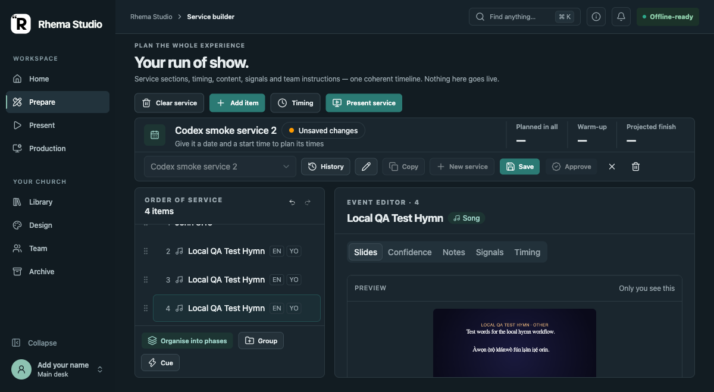

# Issue #386 — Adding a hymn selects its event editor

**Run:** 2026-10-26 · **Surface:** headed Chromium against the isolated Vite dev server on `127.0.0.1:4174`.

## Scenario and result

Started with John 3:16 selected in Prepare, opened **Add item → Hymn book**, selected a synthetic bilingual CAC Main 999 test fixture, then used **Add to service** from its detail pane. The hymn was appended and selected; Prepare showed **Event editor · 4 — Local QA Test Hymn**. Live remained off, and the preview was labelled **Only you see this**.

Before the fix, the hymn was appended but John 3:16 stayed selected. Store tracing showed an older asynchronous Bible translation refresh resolving after the Add action and clearing the selected hymn. The refresh now updates the verse only when that same verse and queue selection are still current.

## Evidence limits

The Hymn Book fixture and service were synthetic and existed only in the browser test shim. This demonstrates the Chromium UI path; it is not a native desktop, real database, projector, TV, OBS/NDI, camera, or Windows acceptance run.

The regression test in `src/components/panels/preview-panel.test.tsx` reproduces the delayed-response race: it fails before the guard and passes after it. The Prepare workflow assertion in `src/studio/prepare/song-library.test.tsx` checks that Add changes the visible editor as well as the selected store ID.
